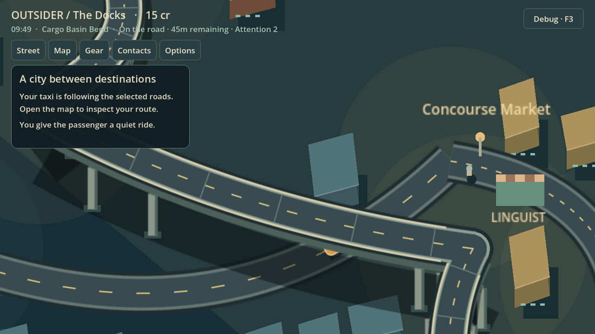

# Supported bridge and ramp presentation — #58

The legal city graph, Curve2D geometry, elevations, travel times and tolls are unchanged. This batch replaces thin floating deck strokes and single pier lines with a visible underside, paired piers/caps/footings, deck joints and continuously tapered ramp retaining faces. A separate retained structure layer places supports and shadows behind ground traffic, while the deck still occludes an actual underpassing taxi and elevated traffic remains above it.

Pier stations sample the authoritative edge and height profile. Low ramp sections use retaining faces instead of short decorative piers. Footings are excluded from ground carriageway clearance, and building placement reserves the actual ground footprint beneath elevated spans. No apparent screen crossing is made into a road or navigation junction.

The existing native journey test traverses the real underpass, connected approach ramp, viaduct and connected descent. It now captures each at both 2.6x and 1.25x zoom with adjacent JSON recording world position, route, segment, elapsed time and zoom. `test_bridge_structure.gd` checks supported span, ground clearance, taper and graph preservation. The retained-layer test checks structure/ground/deck order and prevents facade footprints occupying pier feet.

## Before and after

The before captures are from the earlier PR #62 baseline, not main or an accepted art direction.

| View | Before | After close | After wide |
| --- | --- | --- | --- |
| Underpass | [Baseline](evidence/overnight-2026-10-17/06-underpass.png) | [Supported crossing](evidence/bridge-2026-10-17/06-underpass.png) | [Wide](evidence/bridge-2026-10-17/06-underpass-wide.png) |
| Approach ramp | [Baseline](evidence/overnight-2026-10-17/07-ramp.png) | [Ramp](evidence/bridge-2026-10-17/07-ramp.png) | [Wide](evidence/bridge-2026-10-17/07-ramp-wide.png) |
| Elevated deck | [Baseline](evidence/overnight-2026-10-17/08-deck.png) | [Deck](evidence/bridge-2026-10-17/08-deck.png) | [Wide](evidence/bridge-2026-10-17/08-deck-wide.png) |
| Connected descent | [Baseline](evidence/overnight-2026-10-17/09-connected-descent.png) | [Descent](evidence/bridge-2026-10-17/09-connected-descent.png) | [Wide](evidence/bridge-2026-10-17/09-connected-descent-wide.png) |

These are engineering presentation improvements. Human bridge/street appearance, camera comfort, traffic feel and pacing acceptance remain pending. Generalized elevated street tiles and citywide native vehicle/pedestrian coverage are not claimed.

## Verification

Godot 4.7.2: the combined continuation gates passed **35 domain/adapter + 27 native rendered tests**. After the last drawing-order adjustment, the focused full native underpass/ramp/deck/descent journey passed again and its close/wide captures were inspected. [Logs](evidence/bridge-2026-10-17/verification-logs.zip). The drawing uses separate outline/curb/surface passes to prevent an edge end cap covering a connected road surface; caps occur only at existing elevated graph nodes.
