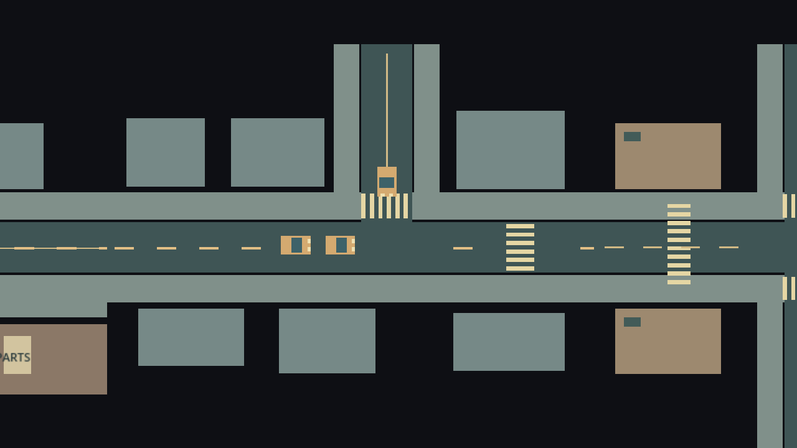
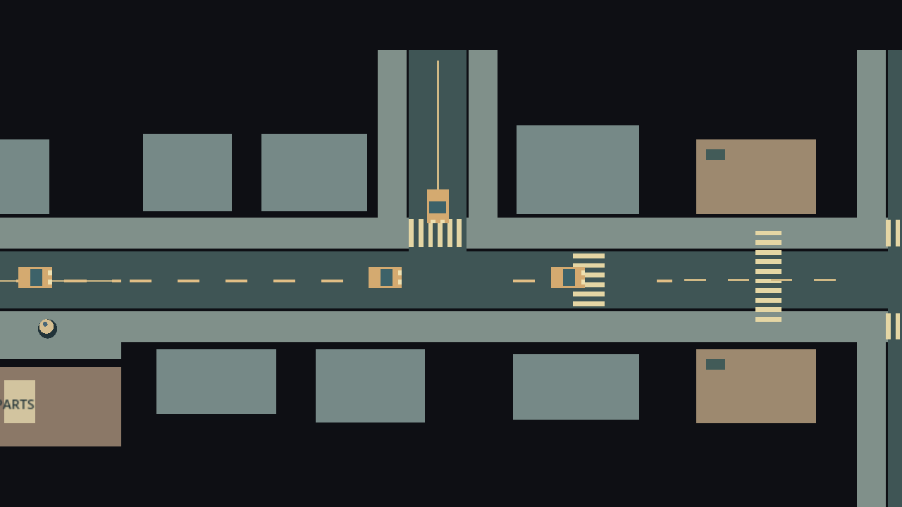

# Local T-junction arbitration

The native street presenter adds three bounded ambient physics cars at the existing east-block T-junction. They have no resident IDs, offers, schedules or economy; the canonical SandboxWorld still owns the actual taxi, shuttle and pedestrian trips. This extends the existing ambient-car demonstration, not the world population or city transport graph.

Main-lane, branch-turn and following approaches request a FIFO conflict-zone token before their stop lines. Entry requires downstream space. Ownership is non-preemptible until the physical body clears the box; no timeout can evict a stopped car. The main and turning routes join one lane with 42px center spacing. Routes terminate before the next junction, so the bounded wait graph has no cycle. Distant citywide arbitration, continuous replenishment and signal networks are outside this slice.

Godot CharacterBody2D collisions remain the final safety boundary. Route progress is measured from physical position, so a collider cannot let a logical car advance through a blockage. Saved local queue order and progress restore native bodies; the conflict owner is reconstructed from the occupied route, rather than trusting a stale saved token. Malformed snapshots with overlapping bodies or two conflict occupants are rejected.

`test_junction_priority.gd` checks FIFO, blocked exits, safe cancellation and non-preemptible occupancy. `test_junction_traffic_scene.gd` uses real physics frames to check stop lines, headway, mutual exclusion, an actual blocking collider, save/reconstruction and eventual queue drain. `web_junction_traffic.cjs` samples actual exported bodies and admission order, then checks saved positions after a real browser reload.

The western marked crossing continues to aggregate the two persistent residents for the real player taxi and world-owned shuttle. This T-junction batch does not claim those world vehicles have native physics at every city junction.

## Verification evidence

Godot 4.7.2: 34 domain/adapter tests passed. The rendered junction test passed including an actual obstruction and restore. Exported Chromium passed admission order `[main, branch, following]`, spacing, queue drain and exact final saved body positions after reload. [Logs](evidence/junction-2026-10-17/verification-logs.zip).

The exported regression exposed a completed-errand lifecycle bug: loading an all-arrived native save skipped the presenter. Saved completed actors now recreate it without recruiting new residents. The two-resident movement test also checks this restore path.
