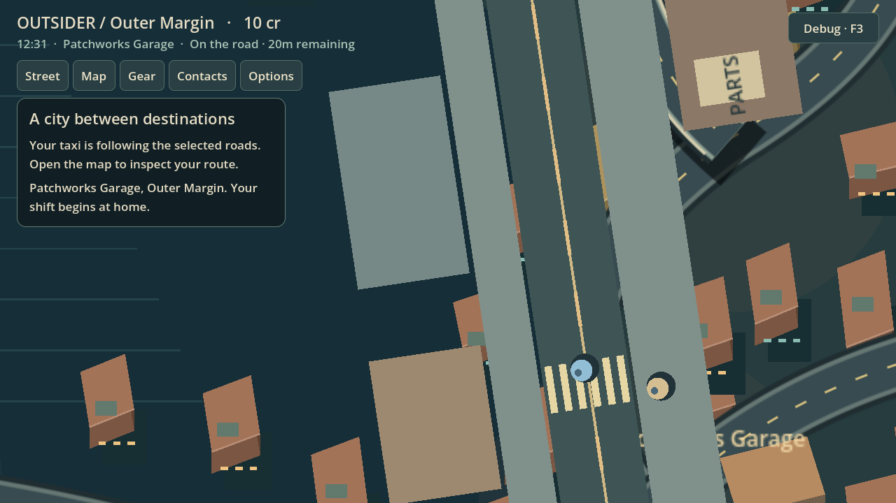

# Bounded two-resident crossing — October 17, 2026

Continues Draft PR #62 from live head `06557e55f99f4fa4137cab62dc0e6f929b2d923b`, on the same branch. PRs #55/#61 remain unchanged.

The presenter now recruits at most two genuinely eligible SandboxWorld residents. Natural seed **29** supplies `npc:04` and `npc:08`, both available at the garage with a relevant need and no pending taxi offer. The population remains nine. Each uses its own CharacterBody2D, NavigationAgent2D, collision body, destination slot, reservation and event history. No second world or synthetic resident is created.

Both the player taxi and the independently generated world-owned shuttle retain their existing world route/hold ledgers. Release requires every relevant physical pedestrian body and reservation to clear. A stale completion flag, a missing actor or one completed crossing cannot release another resident's hold. Cancellation is allowed only with the whole body on pavement. An unreachable path before entry withdraws that resident's reservation; a body blocked in the roadway continues to hold traffic.

Save reconciles the physical actors with their ledgers first, then stores ID-keyed positions and presentation state. Reload restores both identities independently. Unload records each resident's own progress and spatial anchor; same-minute reload preserves it exactly. Distant advancement uses the existing world timeline and records each arrival once. Arrivals and restored presentation are checked against per-ID provenance.

The native test uses a real shuttle produced by seed 29's normal routines (the approach occurs after more than 240 world ticks), rather than inserting a service or editing transit state. Tests stage physical bodies to reproduce staggered entry, blocked paths and stale flags. The exported test instead reaches seed 29 through the existing Debug New Seed control, then exercises ordinary Save/Load and actual movement in desktop and narrow viewports.

## Reproduce

Use Godot **4.7.2** and the repository's `tests/run_city_gate.py` (domain, then `--native` under X11). New checks:

- `test_pedestrian_reservations.gd`: genuine eligibility, bounded recruitment, independent reserve/withdraw/cancel and forged-history rejection.
- `test_two_resident_handoff.gd`: different progress, resume, independently recorded offscreen arrivals and forged presentation rejection.
- `test_two_resident_scene.gd`: two actual agents, unreachable path, collision spacing, independent physical arrivals, embedded lane axis.
- `test_two_resident_crossing_scene.gd`: actual taxi and actual shuttle, staggered reservations, last-body release, save/load, missing actor and exact per-ID unload/reload anchors.
- `test_two_resident_cancel_scene.gd`: safe cancellation leaves the other body's taxi hold intact, including save/load.
- `web_two_residents.cjs`: exported Chromium, natural identities, live save/IndexedDB reload, narrow viewport, body spacing and exactly-once arrivals.

This is a bounded Patchworks crossing, not citywide native pedestrian coverage. Human visual/pacing acceptance and Windows runtime remain unverified. Junction traffic and bridge presentation are separate subsequent batches.

## Evidence

The domain gate passed 32 tests and the native gate passed 25 at the initial multi-resident implementation. Subsequent focused handoff, cancellation, staggered taxi/shuttle and current exported Chromium checks passed after save reconciliation was tightened. A final combined regression gate will cover subsequent batches. [Logs](evidence/multi-resident-2026-10-17/verification-logs.zip).

[Exported native movement](evidence/multi-resident-2026-10-17/multi-two-residents-native.png), [restored narrow viewport](evidence/multi-resident-2026-10-17/multi-two-residents-restored-narrow.png), [independent arrivals](evidence/multi-resident-2026-10-17/multi-two-residents-arrived.png).
