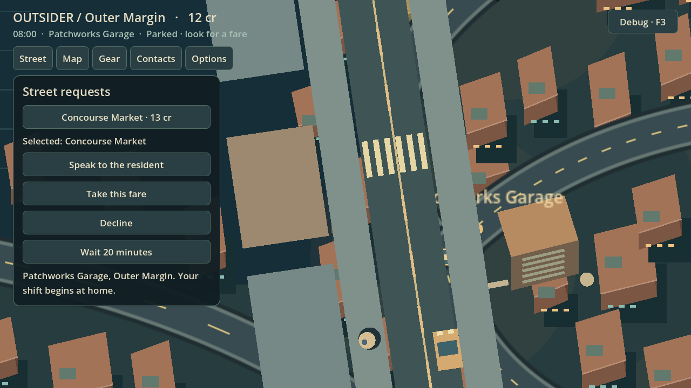
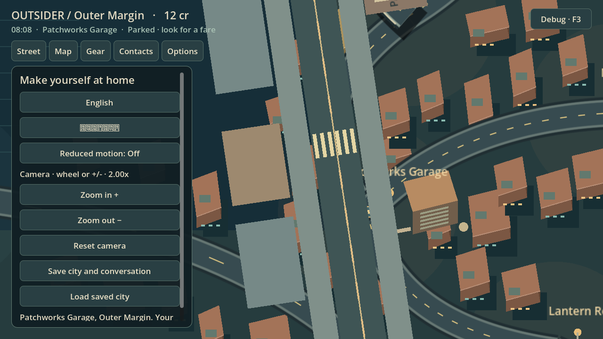
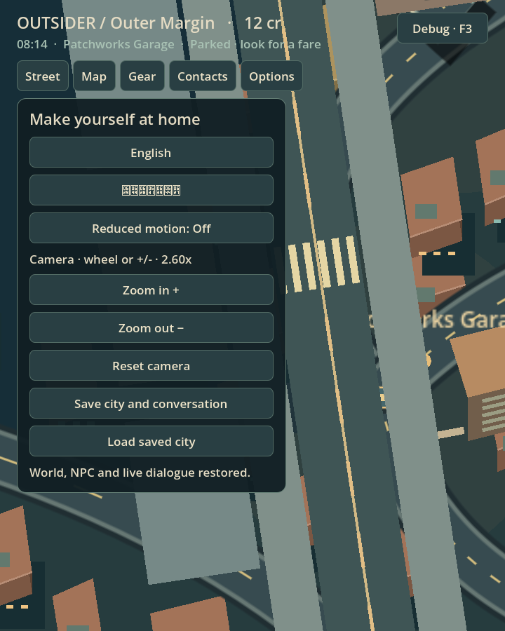
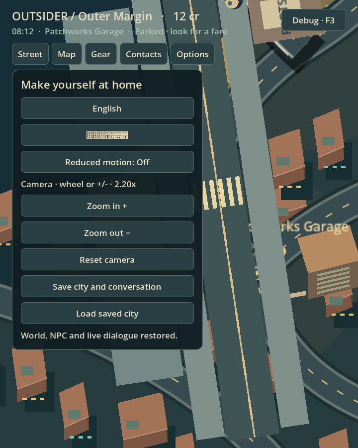
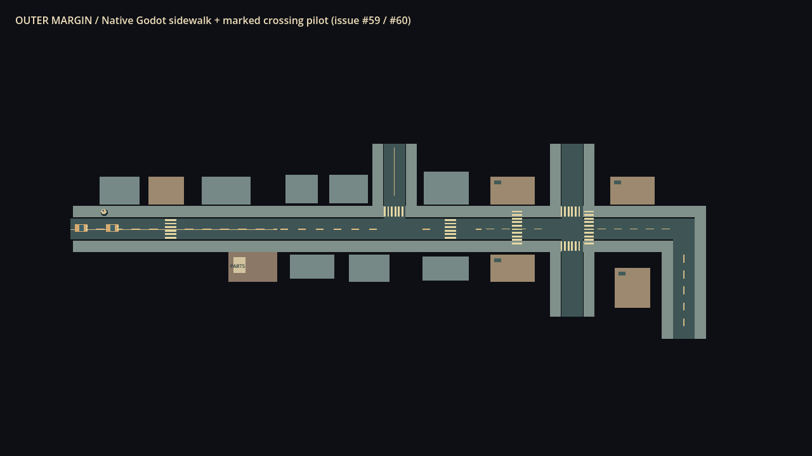

# Sequential completion — October 17, 2026

[Draft PR #62](https://github.com/MohamedXIV/outsider-driver-2d/pull/62) uses the single `codex/overnight-completion` branch, based on `feat/native-pedestrian-crossing-pilot`. Existing PRs #55 and #61 remain untouched and unmerged. No issues or Epics are closed.

Live baseline inspected before implementation: main `05ea3fdd3c5a0484f2b2db7657a639ad919bff30`; #55 `e18aa0cd1444865f0ce7f669590df201ad8de36b`; #61 `983ed8724baf936828bb620f270a387fcbd45b7a`. Final tested gameplay commit: `8ecf70e10834466fa20f159f52fd57c80365029b`. Later evidence/documentation commits do not change gameplay.

## Implemented packages

| Issue | Result and limits |
| --- | --- |
| #56 | Closer 2.6x default; smooth bounded 1.25–4x zoom and follow; wheel, keyboard +/- and translated 44px on-screen buttons; reset; manual preference saved with the city; reduced motion removes easing/lookahead. UI scrolling does not zoom the world. No automatic context zoom competes with the preference. Human framing comfort remains pending. |
| #57 | Reused #61's parked-taxi interpolation fix. Reproduced and corrected the remaining shared-clock freeze during actual concurrent player taxi/shuttle crossing holds. Held actors still clamp their own motion while other residents interpolate. Existing transit, save and event-provenance regressions retained. This does not claim final animation/art acceptance. |
| #49 / #50 | Reused #55 Player Mode and complete fare/Ink flow. Reproduced and fixed 390px overflowing tabs/panels; wrapping tabs/actions, correct panel placement and 44px controls preserve phone access, including Arabic. Portrait art yields space to readable dialogue on phones. |
| #58 | Partial: connected native four-way junction and right-angle corner extend the existing straight/T street kit. The same authored rectangles produce visible roads, sidewalks, regular lots and native navigation; explicit crossing links cross asphalt. Existing world graph/elevation remain authoritative. Citywide street replacement and bridge/ramp presentation are unfinished. |
| #51 / #52 | Existing #55 implementation retained, rather than rebuilt: metric road graph, real Curve2D travel, supported elevations, legal ramps and natural journey lengths. Native journey/grade tests and exported route interactions provide engineering evidence; visual/pacing acceptance remains human work. |
| #59 / #60 | Existing #61 single native resident, two ambient lane cars and real taxi/shuttle crossing holds retained and regression-tested. Multiple simultaneous native residents, reservations and junction traffic remain unimplemented. |
| #48 / #15 | Source/acceptance audit updated. Child implementation is distinguished from open PR merge status and human acceptance. Umbrella Epics remain open. |

## Verification

Pinned runtime: **Godot 4.7.2 stable, `ed1daf0bf`**, native Linux using Mesa llvmpipe/X11 and a real exported Chromium Web build.

- **31/31 domain and adapter tests PASS** using `tests/run_city_gate.py`.
- **23/23 native rendered tests PASS** using `tests/run_city_gate.py --native`.
- **Exported camera/phone Chromium test PASS**: actual wheel, keyboard, on-screen buttons, saved preference/IndexedDB reload, 1280×720, 720×900 and 390×844 Arabic.
- **Exported full Player Mode regression PASS**: real fare, reusable Ink, save/reload midride, exactly one arrival settlement, market/module/AR interactions, scrolling and narrow Arabic.
- **Exported route regression:** **PASS**: two genuine completed fares, 28.16 km / 72 minutes via Depot and 13.97 km / 35 minutes Market→Depot, actual dialogue and exactly two settlements.
- Red/green regressions were observed for the closer camera, route-start lookahead jump, held-taxi shared render clock, 390px layout and missing four-way native module.
- A pre-existing gate assigned the world-shuttle visual test to headless execution even though it waits for `frame_post_draw`; that initial attempt timed out. It now belongs to the native gate and passes there. An initial two-fare run also timed out when its helper clicked outside the scroll-panel clip area; the Web payload/helper now use actual panel clip bounds. The final rerun passed without relaxing gameplay or console-error assertions. A separate 40-command real Wait probe passed. Initial stale export-cache warnings were resolved by rebuilding the export cache.

[Verification logs](evidence/overnight-2026-10-17/verification-logs.zip). The Web export is reproducible from the branch using the pinned editor/templates. No actual Windows runtime, hardware-touch or human aesthetic/pacing acceptance is claimed.

## Captures

| Desktop close | Desktop wide |
| --- | --- |
|  |  |

| Narrow close | Narrow wide |
| --- | --- |
|  |  |

[390px Arabic camera controls](evidence/overnight-2026-10-17/camera-phone-arabic.png).

[Native kit close capture](evidence/overnight-2026-10-17/kit-fourway-corner-close.png). These are prototype navigation modules; the added crossing links do not implement vehicle right-of-way at the new junction.

[Native underpass](evidence/overnight-2026-10-17/06-underpass.png), [ramp](evidence/overnight-2026-10-17/07-ramp.png), [deck](evidence/overnight-2026-10-17/08-deck.png) and [connected descent](evidence/overnight-2026-10-17/09-connected-descent.png) revalidate the existing elevated journey. Adjacent JSON files record authoritative positions; these captures do not claim bridge art has been improved.

## Reuse / replace / retire

Reuse: one SandboxWorld; Ink and language/knowledge semantics; NPC identity, money, schedules and event ledger; legal city road/elevation graph; native Godot NavigationAgent2D/CharacterBody2D and near/far foundation; Player Mode and save presentation bundle.

Replace: fixed camera zoom, abrupt route-start lookahead, shared interpolation suppression during taxi hold and overflowing phone layout. Retire: fixed-zoom expectation only. No duplicate city, population, traffic economy or migration compatibility layer is introduced.

## Remaining and recommended next execution

1. **#59 with #60 safety dependency:** multiple independently eligible persistent residents, per-ID native actor/save state and near/far handoff, physical spacing, exactly-once sourced arrivals. Replace all single-walker crossing assumptions together; taxi and shuttle may release only after every relevant body clears.
2. **#60:** multiple reservations, local junction contention/right-of-way, deadlock prevention and independently owned native municipal fleet actors. Current world-owned shuttle presentation remains route-level, not a physics car fleet.
3. **#58:** supported elevated straight/turn kit, bridge piers/ramps/edge depth/occlusion polish and representative city integration without changing legal grade connectivity.
4. **Human acceptance:** camera comfort, UI/RTL readability, street/bridge appearance, traffic feel and natural trip pacing; actual Windows runtime. Keep #48/#15 open.

Recommended next package: a bounded two-resident native crossing with per-resident reservations and save/unload/reload, tested against the real player taxi plus a genuine world-owned shuttle. This is the next architectural step; extending decorative city coverage first would not resolve the single-actor safety assumptions.
