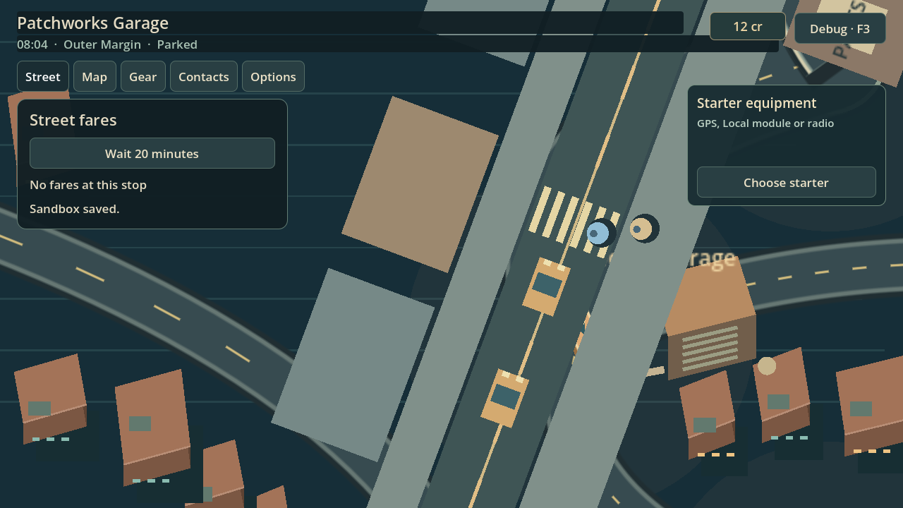
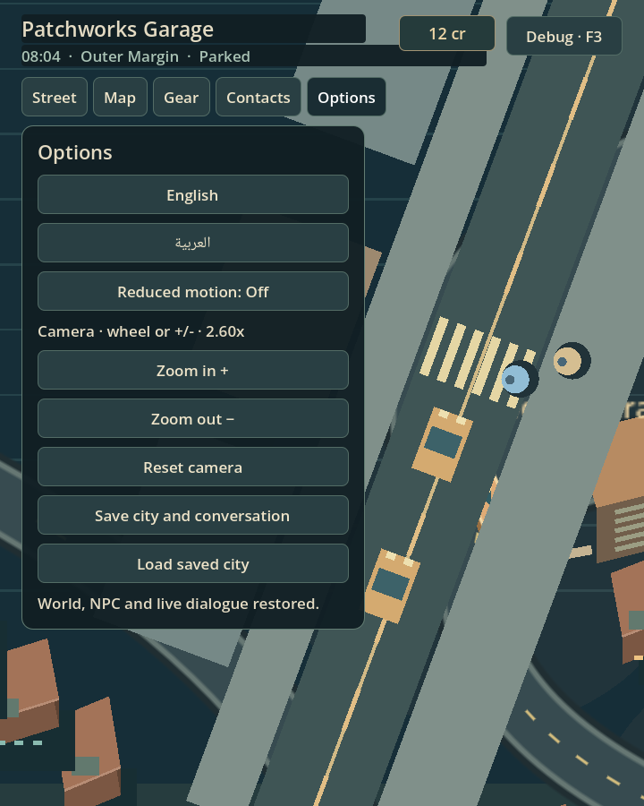
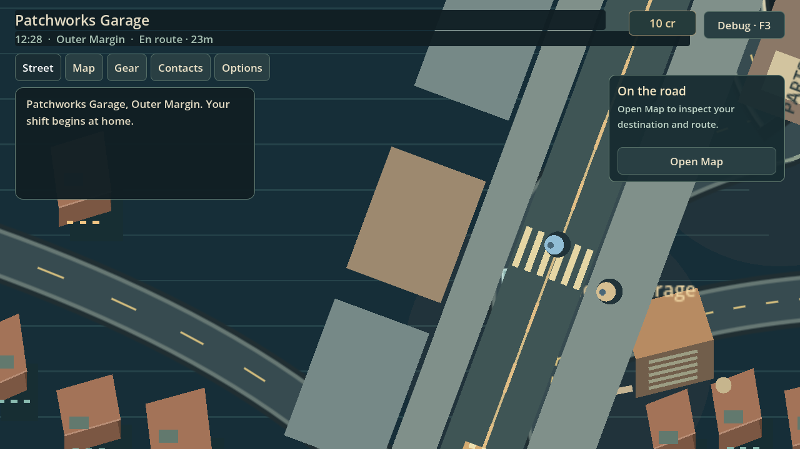

# Living Streets Core P0 — exact-head evidence

Runtime/test head: `3c59a0809749b50cea92db40bb9d76fb87039363`. Godot `4.7.2.stable.official.ed1daf0bf`. PR: https://github.com/MohamedXIV/outsider-driver-2d/pull/83. These files are a documentation-only evidence commit after that tested head.

| Exact-head check | Result |
| --- | --- |
| `python3 tests/run_city_gate.py` | PASS — 49 domain/adapter tests |
| `python3 tests/run_city_gate.py --native` | PASS — 58 rendered native tests |
| `node tests/web_two_residents.cjs` | PASS — exit 0, 269.22 seconds |
| Godot Web export | PASS |

Use the pinned engine via `GODOT_BIN`, create the ignored `work/` scratch directory, and provide a display/Xvfb for native checks. The Web test uses Playwright 1.56.0 against an actual exported current-world build, with `OD2D_WEB_URL` pointing at its HTTP server. The manifest records the exact pack SHA-256. Runs used workspace-local XDG data/config/cache and a two-CPU Linux environment with Mesa/SwiftShader.

## Two genuine residents

Seed 29 naturally supplies `npc:04` and `npc:08` from the existing nine residents. Debug controls select the population seed only; ordinary World ticks initiate the errands. The saved/restored/end telemetry and complete sourced local ledger are in [living-streets-ledger.json](living-streets-ledger.json).

| Resident | Saved body pose | Restore distance | Final body pose | Departures / arrivals |
| --- | --- | --- | --- | --- |
| `npc:04` | (273.735, 312.999) | 0.000000 | (497.110, 408.633) | 1 / 1 |
| `npc:08` | (245.026, 312.999) | 0.000000 | (698.044, 390.999) | 1 / 1 |

Both IDs retain one departure and one arrival. The second body finishes in the adjacent authored block. The native log additionally proves predeparture fractional save continuity, successful saves and genuinely replaced World instances at load, exact mid-crossing poses and ledger preservation, all-frame save/handoff corridor validity, legal crossing, separation and yielding. Existing native suites cover a blocked goal, independent reservations, real taxi/shuttle holds, stale clear flags, missing bodies and unload/reentry.

- [Complete domain summary](domain-summary.log)
- [Complete native summary](native-summary.log)
- [Native ordered body trace](native-living-streets.log)
- [Chromium result](web-two-residents.log) and [build manifest](web-manifest.json)

## Integration and remaining gates

Started from live-verified `5f0aea60`, then preserved the concurrent #77 update `f7b014c`, which includes #81 geometry `0648fc49`. Protected city data, directed lanes, Player UI, `web_city_routes.cjs` and `web_city_playability.cjs` have no diff against `f7b014c`. Both upstream PRs have green exact-head GitHub CI.

A separate broader Web attempt at `abf819f` passed camera and Player Mode playability, then [timed out](long-route-timeout.log) in unchanged `web_city_routes.cjs:81` after 240000 ms while the long route was still progressing (33 planned minutes remaining). This is not classified as pre-existing; the full exported-current gate is not claimed green. No protected assertions were relaxed. Retain this as an automation review gate.

Human Linux/Windows playtests must still assess visibility, waiting/release, pacing and driving feel. Windows runtime was not tested. Scope remains one living block pair and one local errand per eligible resident history, with the existing approximate far policy; this is not citywide recurring street life. Keep the PR Draft and #82 In review. No release, main merge or issue closure was performed.
